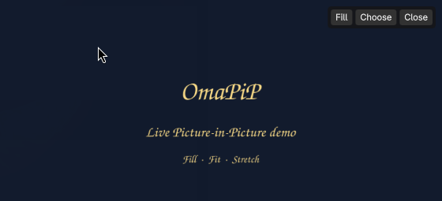
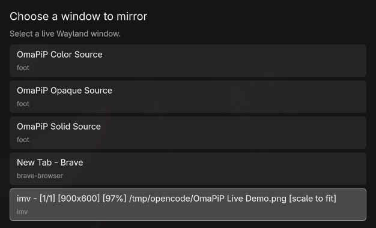

# OmaPiP

<p align="center">
  <strong>Native Picture-in-Picture for Omarchy</strong><br>
  Mirror any Wayland window into a movable, resizable, always-on-top viewer.
</p>

<p align="center">
  <a href="https://github.com/Roddygithub/OmaPiP/actions/workflows/validate.yml"></a>
  <a href="https://github.com/Roddygithub/OmaPiP/releases/latest"></a>
  <a href="LICENSE"></a>
  <a href="https://omarchyplugins.com/plugin.html?id=io.github.roddygithub.omapip"></a>
</p>

<p align="center">
  
</p>

<p align="center"><em>Keep a video, dashboard, build log, call, or reference window visible while you work.</em></p>

<p align="center">
  <a href="#quick-start">Install</a> ·
  <a href="#screenshots">Screenshots</a> ·
  <a href="#controls">Controls</a> ·
  <a href="#known-limitations">Limitations</a> ·
  <a href="#development">Development</a>
</p>

## Why OmaPiP?

Keep any window visible while you work — a video, a dashboard, a build log, a video call, or a reference document. The source window stays exactly where it is; OmaPiP mirrors it into a floating, always-on-top viewer that you can move, resize, and pin across workspaces.

## Features

- **Any selectable Wayland window** — pick from a live list of open windows
- **Keyboard-navigable picker** — arrow to a source, Enter to capture, Esc to dismiss
- **Keyboard-accessible viewer controls** — Tab to toolbar buttons; Enter or Space activates
- **Native Omarchy bar widget** — one-click access from the bar
- **Floating always-visible viewer** — pinned across workspaces, raised above normal windows
- **Freeform move and resize** — drag anywhere to move; drag any edge or corner to resize (no aspect-ratio lock)
- **Fill / Fit / Stretch rendering** — three display modes, cycled from the toolbar
- **Change source without reopening** — *Choose* reopens the picker while capture continues
- **Exact source identity** — tracked by Hyprland address, not fragile titles
- **No automatic source reattachment** — a lost source stays unavailable until explicit selection
- **Explicit unavailable-source handling** — clear prompt when the source window is closed
- **No helper daemon** — runs entirely inside `omarchy-shell` as QML
- **No administrator privileges** — user-level only
- **No capture persistence** — pixels are never written to disk by OmaPiP

## Quick Start

```bash
omarchy plugin add https://github.com/Roddygithub/OmaPiP.git --enable
```

1. Click the **OmaPiP** bar icon in the right section
2. Select a window from the picker
3. Drag the viewer to position it
4. Drag any edge or corner to resize freely
5. Click **Fill** to cycle Fill → Fit → Stretch
6. Click **Choose** to pick a different window
7. Click **Close** to hide the viewer (source window is unaffected)

The images above are genuine captures from an Omarchy/Hyprland session using
neutral demo content. They are cropped to the product surfaces and contain no
personal window data.

## Screenshots




## Controls

| Action | Result |
|--------|--------|
| ↑ / ↓ in picker | Move keyboard selection (clamped at both ends) |
| Home / End in picker | Jump to the first / last source |
| Enter in picker | Open the focused source (same path as a click) |
| Esc in picker | Close picker only; an open viewer keeps running |
| Tab in viewer | Move keyboard focus through toolbar controls |
| Enter / Space on a toolbar control | Activate the focused control |
| Left-click + drag on viewer | Move viewer freely (native compositor move) |
| Drag any edge / corner | Resize freely (4 edges and 4 corners, native compositor resize) |
| Click **Fill** button | Cycle display mode: Fill → Fit → Stretch |
| Click **Choose** | Reopen source picker (capture continues) |
| Click **Close** | Close viewer only; source window unaffected |
| Right-click on viewer | Reopen source picker |
| Source window destroyed | Viewer shows "Choose another window" |
| Capture does not start within 8 seconds | Viewer shows a recovery prompt |

## Display Modes

| Mode | Behavior |
|------|----------|
| **Fill** (default) | Preserve aspect ratio, crop to cover the entire viewer (like `background-size: cover`) |
| **Fit** | Preserve aspect ratio, show entire source; letterboxing may appear (like `background-size: contain`) |
| **Stretch** | Fill viewer exactly; distortion possible |

The viewer keeps its geometry when switching sources or display modes.

## Requirements

- Omarchy with the Quickshell plugin runtime
- Hyprland
- Quickshell with `ScreencopyView` support
- A Wayland session
- Picker minimum size: 300×240; viewer minimum size: 160×90 logical pixels

No minimum versions are enforced beyond what Omarchy itself requires.

## Privacy & Security

- No network access from OmaPiP itself
- No authentication, secrets, or credentials
- No administrator privileges required
- No external helper, daemon, or portal (PipeWire, xdg-desktop-portal)
- Captured frames are not persisted to disk by OmaPiP
- Selected Hyprland address is session state only; never written to config files

See [SECURITY.md](SECURITY.md) for the vulnerability reporting policy and security boundaries.

## Install / Update / Remove

```bash
# Install and enable
omarchy plugin add https://github.com/Roddygithub/OmaPiP.git --enable

# Update (when a new release is published)
omarchy plugin update io.github.roddygithub.omapip --yes

# Disable temporarily
omarchy plugin disable io.github.roddygithub.omapip

# Remove completely
omarchy plugin remove io.github.roddygithub.omapip --yes
```

## CLI / Advanced Use

```bash
# Summon via shell (secondary path)
omarchy-shell shell summon io.github.roddygithub.omapip '{}'

# Inspect internal state (JSON)
omarchy-shell io.github.roddygithub.omapip status

# List available sources (JSON)
omarchy-shell io.github.roddygithub.omapip sources

# Select a specific Hyprland address (bare hex and 0x-prefixed forms are accepted)
omarchy-shell io.github.roddygithub.omapip select '0x123456'

# Reopen picker
omarchy-shell io.github.roddygithub.omapip chooseAnother

# Programmatic placement
omarchy-shell io.github.roddygithub.omapip placeBottomLeft
omarchy-shell io.github.roddygithub.omapip placeBottomRight

# Cycle display mode
omarchy-shell io.github.roddygithub.omapip cycleDisplayMode
```

## Known Limitations

- Multi-monitor behavior has not yet received full validation
- Mixed-DPI behavior has not yet received full validation
- On multi-monitor setups the bar widget is instantiated per monitor; instances share one IPC target name, so CLI routing is not monitor-specific and simultaneous viewers can interfere (a shared service instance is planned for a future release)

## Compatibility & Status

| Item | Status |
|------|--------|
| Current release | v0.1.3 |
| Automated tests | 190 Node assertions across display, source/configuration, picker, and viewer suites; 16 Qt QML runner results (12 test functions plus setup/cleanup) |
| GitHub Actions CI | Node and Qt QML suites plus manifest, required-file, preview, and changed-diff checks |
| Marketplace | Listing status not verified; no marketplace approval or endorsement is claimed |

## Project Structure

```
BarWidget.qml       # Bar widget entry point (Ui.BarWidget + IPC)
Panel.qml           # Picker + viewer logic (FloatingWindow, ScreencopyView)
PanelLogic.js       # Pure logic shared by QML and automated tests
manifest.json       # Omarchy plugin manifest
tests/
  test_display.js   # 86 display/geometry tests
  test_phase_a.js   # Source identity and configuration contract tests
  test_phase_c.js   # Picker keyboard logic tests
  test_phase_d.js   # Viewer identity and accessibility wiring tests
  qml/              # Qt JavaScript-engine and key-delivery tests for shared logic
docs/
  README.md         # Current vs historical documentation map
  *.md              # Research and validation archive
SECURITY.md         # Security policy and reporting
LICENSE             # MIT
```

## Development

```bash
# Run automated Node tests
node tests/test_display.js
node tests/test_phase_a.js
node tests/test_phase_c.js
node tests/test_phase_d.js

# Run shared JavaScript-module smoke tests through Qt (Qt required)
QT_QPA_PLATFORM=offscreen /usr/lib/qt6/bin/qmltestrunner -input tests/qml

# Validate plugin manifest (on Omarchy)
omarchy plugin validate .
```

## Contributing

1. Fork and create a feature branch
2. Make focused changes with clear commit messages
3. Ensure all four Node suites and the Qt tests pass
4. Run `omarchy plugin validate .` locally if on Omarchy
5. Open a PR against `main`

No heavy framework, no boilerplate — small, reviewable diffs preferred.

## Issues

- **Bug reports**: Include Omarchy version, Hyprland version, Quickshell version, steps to reproduce, expected vs actual behavior, logs, and whether multi-monitor is in use
- **Feature requests**: Describe the problem, proposed behavior, and any alternatives considered

Issue templates are available in `.github/ISSUE_TEMPLATE/`.

## License

MIT — see [LICENSE](LICENSE).

---

*OmaPiP is a native Omarchy/Quickshell plugin. It is not affiliated with the Hyprland or Omarchy projects beyond using their public APIs.*
